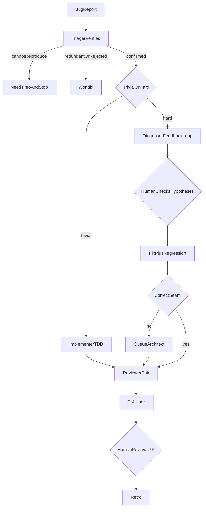

# Flow: Bug

**Entry:** the human reports something broken, failing, slow, or intermittent; or triage surfaces a `bug` ready for an agent.

**Gates:**

1. Human checkpoint on ranked hypotheses (hard path). If the human is AFK, proceed with the Diagnoser's ranking.
2. Human PR review before merge.
3. Retro after the fix lands (same session when possible).

**Cap:** at most **3** failed fix attempts or hypothesis rounds. Then escalate with a handoff (`needs-human`), do not keep looping.

## Procedure

### 1. Triage and verify

- Run skill `triage` (or follow its `SKILL.md`).
- Gather context: issue body, comments, labels; explore with glossary vocabulary.
- Check **redundancy** (already implemented?) and **prior rejection** (`.out-of-scope/`).
- **Reproduce** the claim. Report: confirmed (with code path), failed, or insufficient detail.
- If insufficient: post `needs-info` and **stop**.
- If already implemented or rejected: apply `wontfix` per triage rules and **stop**.
- Otherwise: produce or confirm an **Agent Brief** and treat the bug as agent-ready.

### 2. Classify: trivial vs hard

- **Trivial:** cause is obvious after a successful repro; a first-glance fix is safe.
- **Hard:** resists first glance, intermittent, flake, or regression between known-good states. Also hard if the Orchestrator is not confident.

### 3a. Trivial path

1. Spawn one **Implementer** (or run as a phase in Single-agent mode).
2. Run skill `tdd`: failing test first at an agreed seam, then minimal fix.
3. Run all commands in `docs/factory/checks.md`. Green required.
4. Continue at step 5 (review).

### 3b. Hard path

1. Spawn **Diagnoser**; run skill `diagnosing-bugs`.
2. **Phase rule:** nothing else starts until a tight feedback loop exists.
3. Diagnoser forms ranked hypotheses and presents them.
4. **Gate:** human re-ranks if available; otherwise proceed.
5. Instrument (tagged logs, e.g. `[DEBUG-a4f2]`), one variable at a time.
6. **Fix + regression test:** write the failing regression test **before** the fix, only if a **correct seam** exists (exercises the real bug pattern at the call site).
7. If **no correct seam:** that is the finding. Note it; Orchestrator queues **Architect** (`improve-codebase-architecture`). Still document the hypothesis in the commit/PR.
8. Cleanup: remove tagged instrumentation; re-run the original loop; state the confirmed hypothesis in the commit message.

### 4. Retry and escalate

- Failing checks → one fresh Implementer/Diagnoser retry on the same brief.
- Same failure twice → stop; treat the brief as the likely defect; escalate to the human.
- Count toward the global cap of 3 attempts.

### 5. Review, PR, human gate, retro

1. **Reviewer pair** (`code-review`) against the fixed point (integration branch base or `main`).
2. One fresh Implementer may fix all review findings in a single pass.
3. **PR Author** (`pr`): summary, before/after evidence, door call.
4. **Gate:** human reviews the PR.
5. **Retro** (`retro`): what would have prevented this bug? Mechanical → new check; judgement → coding standard.

## Done when

- Original repro no longer reproduces.
- Regression test passes **or** absence of seam is documented and Architect is queued.
- Checks green; review reported; PR opened; cleanup complete.

## Mode notes

| Mode | Behavior |
| ---- | -------- |
| Full | Triager / Diagnoser / Implementer / Reviewers as subagents; parallel Standards+Spec. |
| Serial subagents | Same roles, sequential; Reviewers still cold and separate when possible. |
| Single-agent sequential | Each role is a phase. Reviewer is a **cold second pass** in a fresh session with only context pointers. **Never skip** the cold Reviewer pass for bug fixes that touch shared code. |
