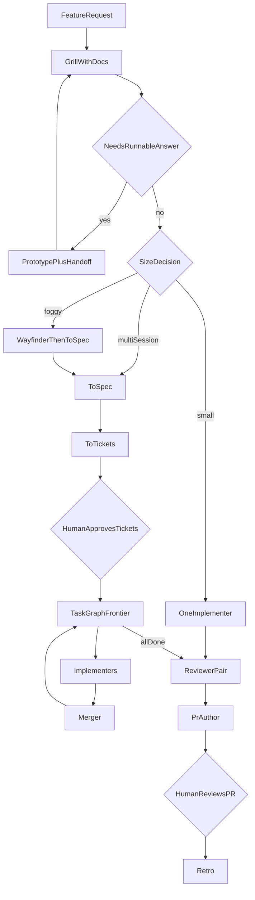

# Flow: Feature

**Entry:** the human asks for a new capability or a substantial improvement.

**Gates:**

1. Grilling (alignment) with the human.
2. Human approval of ticket breakdown (granularity + blocking edges) and test seams.
3. Human PR review before merge.
4. Retro after ship (especially if the build went sideways).

## Procedure

### 1. Grill (gate)

- Run skill `grill-with-docs` (which pulls in `grilling` and `domain-modeling`).
- Update `GLOSSARY.md` and ADRs as decisions land.
- If a question needs a **runnable** answer (state model, UI you must see):
  - `/handoff` out → fresh session in a throwaway directory → `prototype` → `/handoff` back with what you learned.
  - Reference the prototype outcome from the original thread; do not treat prototype code as production.

### 2. Size decision (phase boundary)

At the boundary after grilling, choose:

| Size | Criteria | Next |
| ---- | -------- | ---- |
| **Small** | Fits one fresh context; seams clear | One Implementer (or implement in place if context budget allows) |
| **Multi-session** | Needs a spec and tickets | Continue to step 3 |
| **Foggy / huge** | Path not visible; greenfield or oversized | `wayfinder` first (decision tickets), then hand off to `to-spec` |

Keep grilling → size decision → (spec → tickets) in one unbroken context when the smart zone allows.

### 3. Spec and tickets

1. Run `to-spec`: synthesize (do not re-interview). Confirm test seams with the human. Publish with `ready-for-agent`.
2. Run `to-tickets`: tracer-bullet vertical slices with **blocking edges**. Quiz the human on granularity and edges.
3. **Gate:** human approves the breakdown and seams.

### 4. Implement

**Small path:** one Implementer with `implement` + `tdd`; checks green; jump to step 5.

**Multi-session / after tickets:** follow the `implement-spec` pattern:

1. Optional Explorer pass: shared notes outside the repo for all Implementers.
2. Create the **integration branch**. Open a draft PR after the first merge if the tracker closes work via PRs.
3. Work the **frontier**: every ticket whose blockers are done.
4. Spawn one Implementer per ready ticket (Full: parallel worktrees; Serial: one at a time; Single-agent: one ticket per phase with clear/handoff between tickets).
   - Each Implementer: confirm base = integration tip; `tdd`; merge integration tip into its branch before reporting done.
5. **Merger** lands each finished branch onto the integration branch.
6. Recompute the frontier after each merge; start more Implementers when new tickets unlock.
7. Concurrency cap: start at 3–4 parallel Implementers (Full mode). Lower if merge conflicts dominate.
8. One owner per ticket (`in-progress` / equivalent). Never start a ticket already owned.

### 5. Review, fix, PR, human gate, retro

1. **Reviewer pair** (`code-review`) on the integration branch (or the small-path branch).
2. One fresh Implementer fixes **all** review findings in a single pass.
3. **PR Author** (`pr`); mark draft ready if applicable.
4. **Gate:** human reviews the PR.
5. Close tickets the way the tracker closes work; clean up worktrees.
6. **Retro** (`retro`): environment improvements for the next build.

## Done when

- All tickets resolved (or small path complete).
- Checks green; review reported; PR ready; worktrees cleaned.
- Glossary/ADRs updated from grilling.

## Mode notes

| Mode | Behavior |
| ---- | -------- |
| Full | Parallel frontier Implementers in worktrees; Merger; parallel Reviewers. |
| Serial subagents | Same roles; one Implementer at a time on one branch or sequential worktrees. |
| Single-agent sequential | Spec/tickets stay in Orchestrator context. Each ticket is a phase; clear between tickets. Reviewer is a cold second pass. Do not skip cold review when the change touches shared modules. |
