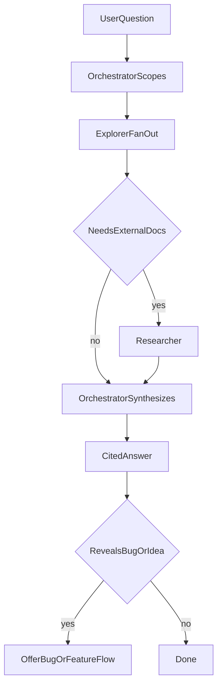

# Flow: Question

**Entry:** the human asks something about the project (how it works, where something lives, why a decision was made).

**Hard rule:** this flow is **read-only**. It must not modify product source, tests, or tracker state. If the answer reveals a bug or a feature idea, offer a handoff into the bug or feature flow with context pointers.

**Gates:** none. The human reads the answer. If it does not land, run `wait-what` and re-pitch using `GLOSSARY.md` vocabulary.

## Procedure

1. **Classify scope.** One module vs cross-cutting. List the areas to explore. Read `GLOSSARY.md` and relevant ADRs first.
2. **Fan out Explorers** (Full / Serial modes: subagents; Single-agent: sequential Explorer phases).
   - One Explorer per area.
   - Brief: question, area, pointers to glossary/ADRs, "write notes outside the repo, report path".
3. **Optional Researcher** if the question needs primary sources outside the repo (API docs, RFCs). Run skill `research`.
4. **Synthesize one answer.**
   - Use project vocabulary.
   - Cite files, symbols, ADRs, and note paths.
   - Surface contradictions between explorers; do not smooth them over.
5. **Handoff offer.** If a bug or feature is implied, stop writing prose and ask whether to enter [flow-bug.md](flow-bug.md) or [flow-feature.md](flow-feature.md). Pass pointers only (no dump of the whole answer into a new prompt unless Single-agent sequential continues in the same window).

## Done when

- The answer cites concrete sources.
- `git status` (or equivalent) shows no factory-driven product edits.
- Mode-specific: Full verified that at least one Explorer subagent returned a report when C1 was claimed.

## Mode notes

| Mode | Behavior |
| ---- | -------- |
| Full | Parallel Explorers (+ optional background Researcher). |
| Serial subagents | Same roles, one after another. |
| Single-agent sequential | Explorer phases in one session; compact only if the smart zone is exhausted between areas. |
